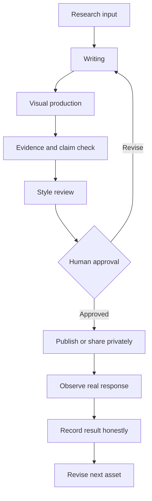
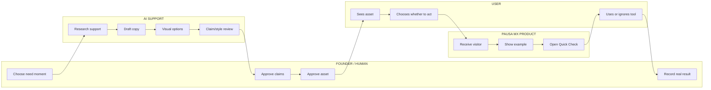

# PACKET — WEEK 15
## Pausa MX — Distribution: Your Method Feeds Your Audience
**Owner:** Diego Gil  
**Role lens:** USER  
**Venture:** Pausa MX  
**Status:** Packet update before implementation

## 1. Problem in my words
Pausa MX already has a working pre-purchase financial check and a Week 14 pricing layer. Week 15 is about distribution: defining one first audience, one moment of need, one bounded promise, and a useful path to action.

The risk is becoming generic “financial wellness” content in a feed crowded with synthetic money advice. The Week 15 slice must demonstrate one concrete purchase decision and lead directly to an honest next action.

## 2. Exact user and moment
**First audience:** Mexican online shoppers considering an installment purchase at or near checkout.

**Moment of need:** the shopper sees a monthly installment amount that looks manageable but has not yet reconstructed how it overlaps with other payments, fees, or commitments.

**Current workaround:** monthly payment + calculator/banking app + memory.

**User vs payer:** the first user is the shopper. Possible later payers remain the shopper for convenience or a buyer-aligned employer/financial-wellness partner. Week 15 is user-first.

## 3. Success definition
Before the module closes:
1. Existing Pausa MX release remains accessible.
2. A shareable Week 15 venture/distribution route clearly names the audience and moment.
3. The promise is concrete and bounded.
4. Brand voice and visual system are documented and implemented.
5. Six concepts exist across three recurring series.
6. Three assets are finished, one per series, across at least two formats.
7. Two finished assets lead to the same working next action.
8. The creative process is visible.
9. Human approval remains required before publication.
10. No asset invents savings, testimonials, reach, clicks, or debt-prevention claims.
11. Actual distribution results are recorded only after a real test.
12. Mechanical and synthetic-persona evidence are preserved.

## 4. Positioning
**Weak line:** “Financial wellness for young people.”

**Week 15 positioning:** Pausa MX is a pre-checkout decision tool for Mexican online shoppers considering installment purchases.

**Evidence-backed promise:** **See the consequence before checkout.**

**Promise we will NOT make:** Pausa MX prevents debt, guarantees affordability, saves a specific amount, or makes the “correct” purchase decision.

## 5. Brand
### Voice rules
1. **Concrete, not dramatic.** Start with one recognizable purchase situation.
2. **Calm, not moralizing.** No shame or “bad with money” language.
3. **Bounded, not absolute.** Show assumptions and uncertainty.

**Weak line:** “Make smarter financial decisions with Pausa MX.”  
**Rewrite:** “Before you tap Buy, see what the payment adds.”

### Visual system
- Deep navy: trust / primary text
- Purple: action / emphasis
- Soft blue-gray: surfaces
- White: background
- Neutral gray: caveats / assumptions
- No red fear styling for ordinary purchase decisions

### Repeatable visual layout
1. purchase situation
2. visible number / consequence
3. one missing question
4. Pausa MX check
5. bounded CTA

## 6. Image-generated mockup
Generate a Week 15 campaign-system mockup showing:
- one vertical story asset
- one square share-card asset
- one landing-page content block
- navy/purple Pausa MX styling
- example copy: “MX$999 x 12 looks small. ¿Qué más cae ese mes?”
- CTA: “Haz el Quick Check”
- visible uncertainty label
- no fake testimonials or metrics

Expected path:
`assets/mockup-pausa-mx-w15.png`

## 7. Creative range — 3 series / 6 concepts
### SERIES A — Antes de comprar
**A1 — FINISHED:** “MX$999 x 12 looks small. ¿Qué más cae ese mes?”  
Format: square share card. CTA: “Haz el Quick Check.”

**A2 — SKETCH:** “El pago mensual no es toda la decisión.”  
Format: short vertical story/reel concept.

### SERIES B — Lo que falta en checkout
**B1 — FINISHED:** “Checkout te muestra la venta. Pausa MX te muestra lo que falta.”  
Format: vertical 3-panel story/carousel. CTA: “Ver el ejemplo.”

**B2 — SKETCH:** “¿Y si cae en la misma quincena que tus otros pagos?”  
Format: comparison card.

### SERIES C — Haz la cuenta conmigo
**C1 — FINISHED:** “Compra: MX$6,000. 6 pagos. ¿Qué cambia?”  
Format: interactive landing-page block. CTA: “Prueba con tus números.”

**C2 — SKETCH:** “Dos compras, mismo pago mensual. ¿Misma decisión?”  
Format: side-by-side comparison.

## 8. Real input → method → useful output
**Input:** invented demo scenario, clearly labeled:
- product price MX$11,988
- 12 installments
- displayed payment MX$999/month

**Method:**
1. Research the purchase moment.
2. Draft one bounded question.
3. Create the visual.
4. Check every claim.
5. Review brand style.
6. Revise for clarity.
7. Human approval before publication.

**Output:**
“MX$999 x 12 looks small. ¿Qué más cae ese mes?”

Then:
“Pausa MX does not approve or reject the purchase. It helps you see the commitment before checkout.”

CTA:
“Haz el Quick Check.”

## 9. Creative process

### Role checks
| Role | Input | Output | Quality check |
|---|---|---|---|
| Research | purchase situation | grounded scenario | Is it realistic and labeled? |
| Writing | scenario + product truth | hook/body/CTA | Is every claim defensible? |
| Visual | approved copy | asset | Does it demonstrate the product? |
| Claim check | draft | approved/rejected claims | Any invented result or false certainty? |
| Style review | checked asset | on-brand version | Calm, concrete, bounded? |
| Human approval | final draft | publish/revise | Would I defend every line to a user? |

## 10. Actor flow

## 11. Distribution test
**Audience:** Mexican online shoppers considering installment purchases.  
**Channel:** permission-based one-to-one outreach or a shareable venture page sent to opted-in contacts.

**Two pieces to test:**
- A1: “MX$999 x 12 looks small...”
- B1: “Checkout te muestra la venta...”

**Same next action:** both lead to the working Quick Check.

Record only what actually happens:
- number who actually received it
- observable opens/clicks
- Quick Check starts if observable
- replies
- confusion/rejection
- completed next action

**Evidence rule:** zero response is valid. A like is not adoption. A click is not validated demand.

## 12. Expected result — before testing
Hypothesis only:
A concrete installment example should create more useful attention than generic financial-wellness copy because it mirrors the immediate decision.

The test may disconfirm this.

## 13. Honest results — fill only after real test
### A1
- Sent/shared to:
- Observable reach:
- Clicks/opens:
- Quick Check starts:
- Replies:
- Result:
- Keep/change:

### B1
- Sent/shared to:
- Observable reach:
- Clicks/opens:
- Quick Check starts:
- Replies:
- Result:
- Keep/change:

Do not complete until the real test occurs.

## 14. Benchmark / local adaptation
### NerdWallet calculators
Gets right: content leads directly into a useful tool.  
Local adaptation: narrower purchase moment, MXN, installment language, Mexican checkout context.

### Rocket Money Learning Hub
Gets right: education lives close to product action.  
Local adaptation: no broad curriculum and no implication of bank-connected automation.

### PROFECO consumer guidance
Gets right: practical, concrete consumer decision guidance.  
Pausa MX difference: interactive personal consequence check; no claim to be a regulator or public authority.

## 15. Shadow clause
**Harm:** turning financial anxiety into engagement bait.

**Design decisions:**
- no shame
- no fake urgency
- no countdowns
- no invented testimonials
- no debt-prevention claims
- no fabricated savings
- no partner control over message
- uncertainty visible
- buyer-controlled action
- human approval before publication

## 16. Scope cut
Not building:
- public influencer account
- ten-post quota
- paid ads
- purchased followers
- automated publishing
- autonomous agent framework
- bank/lender/retailer integrations
- personalized financial profiling
- debt counseling
- full budgeting
- fake waitlist demand
- fake analytics
- fake testimonials
- broad “Gen Z finance” strategy

## 17. Architecture / stack delta
Week 15 reuses the existing Week 14 application.

| Layer | Week 15 use |
|---|---|
| Next.js + React + TypeScript | keep existing product and add distribution route/components |
| Tailwind | campaign system and brand layout |
| Zod | validate any new input/capture |
| Deterministic finance logic | unchanged |
| localStorage | existing local scenarios/analytics |
| Static assets | campaign creative |
| Analytics | safe categorical events only |
| Vercel | preserve deployment history |
| AI | assist research/writing/visual review; never auto-publish |

## 18. Safe campaign analytics
Allowed:
- `campaign_asset_viewed`
- `campaign_cta_clicked`
- `quick_check_from_campaign_started`
- `venture_page_viewed`

Safe metadata:
- series ID A/B/C
- asset ID A1/B1/C1
- route
- timestamp
- anonymous session ID

Never log financial values, income, expenses, names, emails, or contact identities.

A campaign click is not adoption.

## 19. Mechanical test plan
### Distribution route
- audience visible
- promise visible
- forbidden promise absent
- CTA reaches Quick Check
- no asset route 404s

### Brand/copy
- no “prevents debt”
- no “guaranteed affordability”
- no invented savings
- no shame/fear language
- uncertainty visible where needed

### Assets
- A1 renders
- B1 renders
- C1 renders
- at least two formats represented
- every finished asset has one next action

### Analytics
- one event per intended action
- asset ID allowlisted
- no financial values in event metadata
- CTA event is not labeled adoption/conversion

### Regression
- Quick Check still works
- `/pricing` still works
- `/about` still works
- saved scenarios still work
- Week 14 tests remain passing

Do not invent a bug. If a real reproduced failure appears, fix it, add regression coverage, and redeploy.

## 20. Synthetic persona test
**Mariana, 27**
- shops online several times per month
- understands monthly payment better than total commitment
- uses calculator and bank app
- dislikes generic budgeting content
- distrusts dramatic financial advice
- ignores content that feels like an ad

Pressure-test:
- Does she recognize the purchase moment?
- Does the hook feel useful or manipulative?
- Does she understand what Pausa MX does?
- Is the CTA obvious?
- Does she know the example is illustrative?
- Would it feel like generic AI finance content?
- Does the visual earn enough trust to click?

Fix the worst reproduced confusion and retest.

This remains synthetic and does not replace real audience evidence.

## 21. Three-year direction
If this slice works, Pausa MX becomes a trusted pre-purchase decision layer whose distribution is built from useful decision demonstrations rather than generic financial content. The content system would turn real purchase situations into transparent examples that lead directly into the tool while preserving independence, evidence, and buyer control. The brand advantage is not volume; it is being recognizable for one calm, useful moment before checkout.

## 22. Commit/deployment plan
Preserve the existing venture history. Do not create artificial commits.

Meaningful Week 15 commits may include:
1. `docs: update packet for week 15 distribution`
2. `feat: add week 15 venture positioning`
3. `feat: add campaign asset system`
4. `feat: add shareable campaign route`
5. `feat: instrument safe campaign analytics`
6. `test: cover week 15 distribution constraints`
7. `fix: <only if a real reproduced failure exists>`
8. `docs: record week 15 decisions and audience test`

## 23. Session Close
1. Update `DECISIONS.md`.
2. Record next first move.
3. Run tests.
4. Run production build.
5. Check diff.
6. Commit.
7. Push.
8. Verify deployment.
9. Record only real audience-test results.

## 24. Week 15 decision
The first audience is not “young people who want financial wellness.”

It is:

**Mexican online shoppers considering installment purchases at or near checkout.**

The distribution strategy is:

**Demonstrate one concrete purchase decision, show uncertainty honestly, and lead directly to the Quick Check.**
