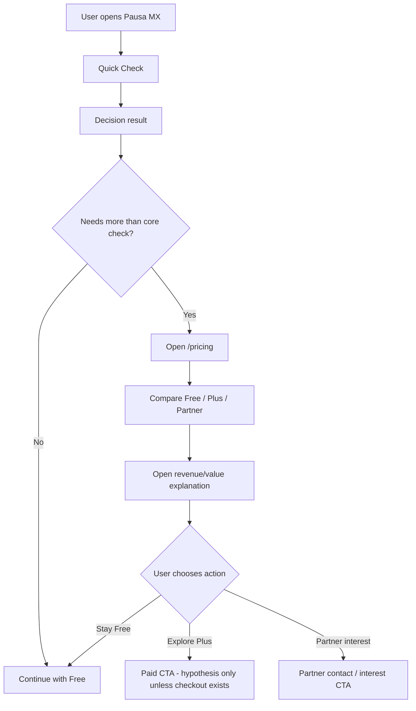
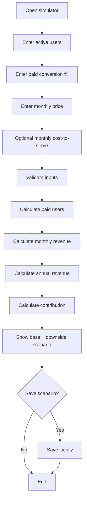
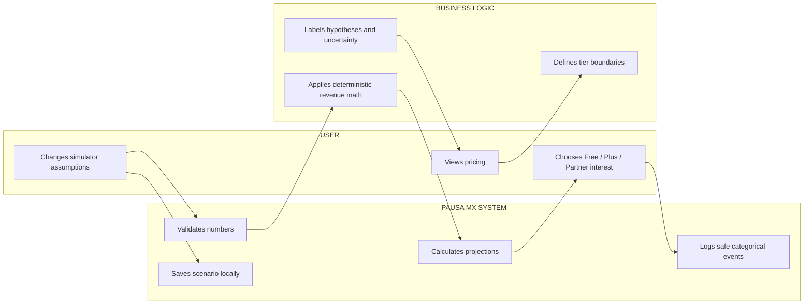

# PACKET — WEEK 14
## Pausa MX — Pricing: The Number That Tells the Truth
**Owner:** Diego Gil  
**Role lens:** TECHNOLOGIST  
**Week:** 14  
**Status:** Packet before code

---

## 1. Problem in my words

Pausa MX already helps a shopper pause before a purchase and see the consequence of installment payments. Week 14 adds the business truth: the venture needs a real price, a visible free-vs-paid line, and a revenue model whose assumptions anyone can inspect.

The risk is pretending that a pricing page or simulator proves demand. Software can calculate revenue and track clicks, but it cannot turn a hypothetical conversion rate into willingness to pay. This slice must therefore make pricing measurable without hiding uncertainty.

---

## 2. Exact user

### Primary user
A Mexican online shopper, roughly 18–35, who buys with installments or credit, wants a fast pre-purchase check, and will not complete a full budgeting workflow every time.

### Potential payer segment 1
The same shopper, if repeated convenience creates enough value to justify a paid plan.

### Potential payer segment 2
A buyer-aligned organization such as an employer benefits program or financial-wellness partner that may pay for access without controlling Pausa MX's recommendation.

### Existing alternative
Calculator + banking app + memory.

The alternative is familiar and usually costs MX$0, so Pausa MX cannot charge for arithmetic alone.

---

## 3. Success definition

Before the Week 14 module closes:

1. `/pricing` is live.
2. It shows 2–3 tiers and two customer segments.
3. The free-vs-paid boundary is explicit.
4. A revenue simulator accepts:
   - active users
   - paid conversion %
   - monthly price
   - optional estimated monthly cost-to-serve
5. It outputs:
   - paid users
   - monthly revenue
   - annual revenue
   - estimated monthly contribution
   - downside scenario
6. Users can save at least three simulator scenarios locally.
7. `/about` includes a one-page 10:1 Memo.
8. Pricing assumptions are visibly labeled as hypotheses.
9. Analytics distinguish page views, simulator usage, CTA intent, and actual payment evidence.
10. No core financial safety result changes because of plan tier.
11. Mechanical tests find and fix at least one real bug.
12. Persona testing finds and fixes at least one major confusion.

---

## 4. Image-generated mockup

Use the generated Week 14 Pausa MX pricing mockup as the visual reference for this build.

**Expected repo asset path:**  
`assets/mockup-pausa-mx-w14.png`

The mockup is directional, not pixel-perfect. Preserve the existing Week 13 visual system where it conflicts with this concept.

---

## 5. Product flow

### 5.1 User pricing flow

### 5.2 Revenue simulator flow

### 5.3 Swimlane

---

## 6. Benchmark line

**Best existing global benchmark:** Rocket Money uses a Free tier plus paid Premium options and treats pricing itself as part of the product experience.

**How Pausa MX differs/localizes:** Pausa MX is a narrower Mexican pre-purchase decision tool, so it cannot copy U.S. personal-finance pricing; it must compete against a strong free substitute and keep the core financial result independent from who pays.

Additional reference points:
- YNAB: premium full-budgeting subscription.
- PocketGuard: recurring and lifetime pricing around ongoing budgeting/automation.

These are benchmarks, not proof that Pausa MX can charge the same amount.

---

## 7. Pricing hypothesis

### Tier 1 — Free
**Price:** MX$0  
**Segment:** individual shopper  
**Includes:**
- core Quick Check
- deterministic purchase math
- uncertainty labels
- buyer-controlled result
- core safety/decision guardrails
- up to 3 saved simulator scenarios

### Tier 2 — Plus
**Starting hypothesis:** MX$59/month  
**Segment:** frequent individual shopper  
**Potential paid convenience:**
- saved preferences
- purchase history
- more saved scenarios
- richer exports
- optional alerts/reminders
- convenience features only

**Never paywalled:**
- truthful math
- uncertainty
- safety wording
- ability to continue or wait
- core recommendation logic

### Tier 3 — Partner
**Starting hypothesis:** pricing not validated  
**Segment:** employer benefits / financial-wellness partner  
**Possible value:**
- program access
- aggregate non-financial usage reporting
- deployment/support tooling

Partner payment must never change the shopper-facing recommendation.

---

## 8. Revenue simulator assumptions

### Required inputs
- active users
- paid conversion rate (%)
- monthly paid price (MXN)

### Optional input
- estimated monthly cost-to-serve per paid user

### Outputs
- paid users
- monthly revenue
- annual revenue
- monthly variable cost
- monthly contribution
- annual contribution
- downside case

### Default hypotheses
Defaults are examples only and must be labeled visibly:
- 300 active users
- 5% paid conversion
- MX$59/month
- MX$10/month cost-to-serve
- downside conversion: 1%

No default may be presented as observed market data.

---

## 9. 10:1 Memo structure for `/about`

### What the user does today
A shopper reconstructs affordability using a calculator, banking app, installment dates, and memory.

### What it costs
- direct money: usually MX$0
- time: unmeasured
- cognitive effort: multiple tools / repeated reconstruction
- risk: missed overlapping payments, unknown fees, or misunderstood total commitment

### Pausa MX price hypothesis
- Free: core check
- Plus: MX$59/month test price

### Why 10:1 might hold
The plausible 10:1 case is not “better arithmetic.” It is reducing the effort required to surface a financially meaningful consequence before checkout.

### What is still unverified
- actual time saved
- repeated use
- willingness to pay
- paid conversion
- frequency of avoided mistakes
- employer/partner willingness to pay

Therefore, the 10:1 case remains a hypothesis until measured.

---

## 10. Long-view — 3 years

If this slice works, Pausa MX becomes a trusted Mexican pre-purchase decision layer rather than a generic budgeting app. It could combine purchase checks, saved personal constraints, transparent pricing, and buyer-aligned benefits partnerships while keeping the financial decision under the user's control. The load-bearing wall is independence: no payer, retailer, lender, or paid tier can alter the core financial truth shown to the user.

---

## 11. Scope cut — what I am NOT building

This week I am not building:

- bank connections
- card/account aggregation
- lender integrations
- retailer integrations
- dynamic personalized pricing
- AI-generated affordability verdicts
- credit recommendations
- real lending offers
- a marketplace
- full budgeting
- production billing unless needed for a safe test
- remote storage of financial inputs
- personal financial profiles
- partner dashboards with individual financial data
- claims that MX$59 is validated
- claims that conversion defaults are market evidence

---

## 12. Architecture + stack

| Layer | Technology | Purpose |
|---|---|---|
| Frontend | Next.js + React + TypeScript | pricing UI, simulator, about memo |
| Styling | Tailwind CSS | responsive visual system |
| Validation | Zod | validate all pricing/simulator inputs |
| Finance / revenue logic | deterministic TypeScript | pricing projections and downside math |
| Scenario storage | browser localStorage | save simulator scenarios without remote personal data |
| Analytics | local/browser-safe event log | funnel instrumentation without financial values |
| Tests | Vitest + Testing Library | logic, UI states, accessibility, regression |
| Deployment | Vercel | production URL |
| AI | none required for pricing math | no AI-generated pricing truth |

---

## 13. Safe analytics events

Allowed event names:

- `pricing_viewed`
- `tier_free_viewed`
- `tier_plus_viewed`
- `tier_partner_viewed`
- `simulator_started`
- `simulator_completed`
- `scenario_saved`
- `scenario_deleted`
- `plus_cta_clicked`
- `partner_cta_clicked`
- `ten_to_one_memo_viewed`

Never log:
- purchase price
- installment amounts
- income
- expenses
- user-entered financial values
- names
- email
- full comments
- fingerprinting data

A CTA click is intent telemetry, not payment evidence.

---

## 14. Security floor

1. No secrets in code or repo.
2. No auth is required if Week 14 continues using only local, non-personal scenario storage.
3. If remote personal data is introduced, Supabase Auth + RLS becomes mandatory before deploy.
4. All numeric inputs must use type/range validation.
5. No real personal financial data in demos or seeds.
6. Financial calculations remain deterministic.
7. Simulated data is labeled.
8. Saved scenarios must be deletable locally.

---

## 15. Test plan

### Mechanical pass

#### Pricing UI
- `/pricing` loads
- 2–3 tiers visible
- Free/paid distinction understandable
- two customer segments visible
- Plus price explicitly labeled as hypothesis
- core financial truth is not paywalled

#### Simulator logic
- users cannot be negative
- conversion constrained to 0–100%
- price cannot be negative
- cost cannot be negative
- monthly revenue = paid users × price
- annual revenue = monthly revenue × 12
- contribution subtracts variable costs
- downside scenario uses visibly different conversion assumption
- rounding is consistent
- zero-user case works
- zero-conversion case works
- 100%-conversion case works
- invalid text does not calculate

#### Saved scenarios
- save one scenario
- save at least three scenarios
- reload page and retain scenarios
- delete scenario
- corrupted local data fails safely
- duplicate names handled safely

#### 10:1 Memo
- current alternative visible
- direct cost described honestly
- unmeasured time/risk labeled
- price visible
- unverified claims labeled
- no “10:1 proven” language

#### Analytics
- one pricing-view event per page view
- simulator completion only after valid calculation
- scenario save only after successful save
- CTA event does not masquerade as conversion/payment
- no financial values enter metadata

### Persona pass

Synthetic persona:
**Mariana, 27**, shops online several times per month, understands monthly payments better than total commitment, uses her banking app and calculator, dislikes budgeting apps, and becomes skeptical when a financial app asks for a subscription.

Questions to pressure-test:
- Does she understand what remains free?
- Does MX$59/month feel like a charge for math?
- Can she understand the simulator without thinking the projection is a promise?
- Does she know the numbers are hypotheses?
- Does she confuse “Plus” with a safer recommendation?
- Does “Partner” make her suspect employer/retailer influence?
- Can she delete saved scenarios?
- Would she quit because the pricing page is too business-oriented?

Fix the worst confusion and redeploy.

---

## 16. Commit plan

Minimum planned commits:

1. `docs: establish week 14 pricing packet`
2. `feat: add pricing tiers and free paid boundary`
3. `feat: add deterministic revenue simulator`
4. `feat: add local saved pricing scenarios`
5. `feat: add 10 to 1 memo`
6. `feat: instrument safe pricing analytics`
7. `test: cover pricing and simulator constraints`
8. `fix: resolve mechanical test failure`
9. `fix: resolve persona test confusion`
10. `docs: record week 14 decisions and risks`

At least two production deploys:
- Deploy 1: first complete pricing slice
- Deploy 2: after mechanical/persona fix

---

## 17. Session Close rule

At the end of every build session:

1. Update `DECISIONS.md`.
2. Record the next first move.
3. Run tests.
4. Run production build.
5. Check git diff.
6. Commit.
7. Push.
8. Verify production deploy.

---

## 18. Decision this packet makes

Week 14 treats pricing as a product hypothesis, not a decorative business number.

The pricing page must expose the offer clearly.  
The simulator must expose the assumptions clearly.  
The analytics must expose behavior without pretending behavior equals payment.  
The free tier must preserve the same financial truth as the paid tier.

**TECHNOLOGIST position:** pricing infrastructure is commodity; pricing evidence is not.
